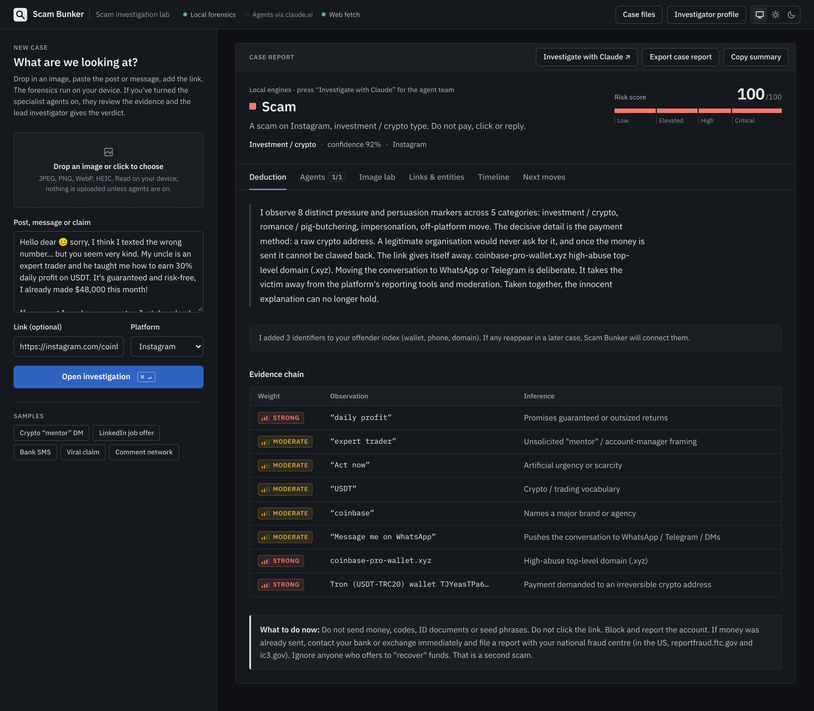
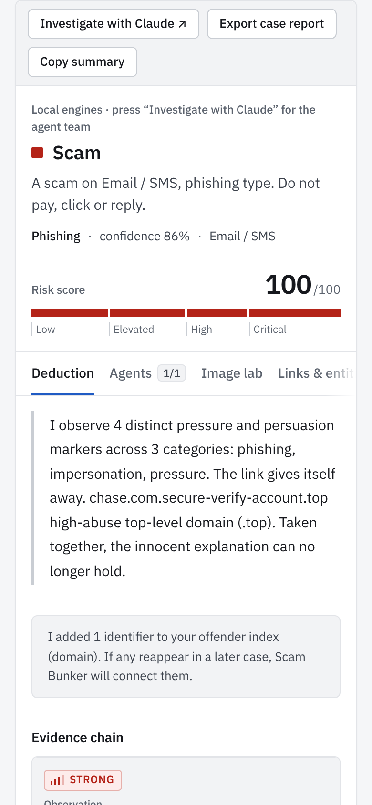

# Scam Bunker

**An open-source lab for identifying scams, profiling repeat offenders, and debunking disinformation and manipulated images.**

Drop in an image, a post, a DM or a link. Scam Bunker dates the image, checks whether AI generated it, pulls out the information hidden in the file, takes the links apart, and classifies the scheme. With an API key it also hands the evidence to a team of AI specialists. A lead investigator, modelled on Sherlock Holmes's method, cross-examines their reports and delivers the verdict.


<p>
  
  
</p>

The interface follows a small design system documented in [docs/DESIGN.md](docs/DESIGN.md).

## What it does

| Capability | How |
|---|---|
| **Dates an image** | EXIF `DateTimeOriginal`/`Digitized`, XMP create/modify, Photoshop edit history, PNG `tIME`, GPS date stamps. Each is ranked by how far it can be trusted and shown on a timeline |
| **Detects AI generation** | C2PA / Content Credentials, IPTC `DigitalSourceType = trainedAlgorithmicMedia`, embedded Stable Diffusion / ComfyUI prompts, and signatures from Midjourney, DALL·E, Firefly, Imagen, FLUX, Ideogram, Leonardo and others. Generator canvas sizes and noise statistics count only as weak signals |
| **Exposes hidden data** | GPS (with map), camera serial number, owner and author fields, original-document IDs, embedded prompts and comments |
| **Detects manipulation** | Error-level analysis heatmap with hotspot statistics, editing-software traces, impossible timestamp orderings |
| **Traces where it's been** | Facebook `FBMD` markers, platform resize dimensions (Instagram, Facebook, X, WhatsApp), stripped EXIF, recompression quality |
| **Classifies scams** | Phishing, investment/crypto, romance/pig-butchering, job/task, giveaway, advance-fee, impersonation, tech support, recovery scams, marketplace fraud |
| **Detects coordination** | Copy-paste comment rings, hashtag stuffing, mass-tagging, "my advisor" testimonial networks |
| **Dissects links** | Typosquats, punycode homographs, brand-in-subdomain tricks, `@` tricks, shorteners, high-abuse TLDs, redirect chains, tracking parameters |
| **Profiles repeat offenders** | Every case adds the scammer's wallets, handles, phone numbers, emails, domains, image hashes and camera serials to a local offender index. New cases are matched against it automatically, and reuse is flagged as strong evidence |
| **Extracts entities** | Crypto wallets (with block-explorer links), phone numbers, handles, emails, money amounts |
| **Agent team** | Image Forensics (vision), Fraud Analyst, OSINT & Platform Analyst and Fact Checker run in parallel. The Lead Investigator then reconciles their reports and returns a structured verdict |

Every finding is labelled **proof**, **strong** or **weak**. Missing metadata is never treated as proof of AI.

## Quick start

Requires Node.js 22 or later. There are no dependencies to install.

```bash
git clone https://github.com/mevan101/scam_bunker.git
cd scam_bunker
cp .env.example .env    # optional — works with no keys at all
npm start               # → http://localhost:4400
```

## Running the agent team: no API key required

| Mode | Setup | Cost |
|---|---|---|
| **Investigate with Claude** | None. The button packs the case and all five agent roles into one prompt and opens claude.ai | Your existing Claude plan |
| **Ollama (local)** | Install [Ollama](https://ollama.com), then run `ollama pull gemma3`. Scam Bunker detects it on start | Free, offline, private |
| **OpenAI-compatible API** | `LLM_BASE_URL`, `LLM_API_KEY`, `LLM_MODEL` (Groq, OpenRouter, LM Studio and others) | Free tiers available |
| **Anthropic API** | `ANTHROPIC_API_KEY` | Pay per use |

With a vision-capable model (Gemma 3, Llama 3.2 Vision, Qwen-VL, Claude), the Image Forensics agent looks at the image itself as well as the metadata. Text-only models fall back to the metadata automatically. Add `FIRECRAWL_API_KEY` to fetch pages and search the web for corroboration. See `.env.example`.

## Make it your investigator

Open **Investigator profile** and describe who you are, what you investigate and how you want the reasoning done. You can paste in the instructions of an existing assistant, such as your own "Sherlock" bot. Every agent reads this profile before it starts.

## Privacy

Images are parsed **in your browser**. Nothing leaves your machine unless you choose to. With Ollama, nothing ever leaves it. With a cloud provider or the claude.ai handoff, the extracted findings (and, for vision models, a downscaled copy of the image) go to that provider. Case history lives in your browser's localStorage.

## Architecture

```
public/forensics.js   image container parsers (JPEG/PNG/WebP/HEIC), EXIF/XMP/IPTC/C2PA, ELA, AI signatures
public/scam.js        rule engine: scam patterns, link analysis, entity extraction, coordination signals
public/app.js         case orchestration, local reasoning, UI
server.js             zero-dependency Node server: static files + /api/agent, /api/lead, /api/fetch, /api/search
test/run.js           npm test
```

## Limitations

- Metadata can be forged or stripped. Scam Bunker reports what the file says and how far to trust it.
- Statistical AI detection is unreliable on its own. Scam Bunker treats it as a weak signal by design.
- Facebook, Instagram and LinkedIn block anonymous page fetches. Paste the post text instead.
- This is an aid to judgement and does not replace it. Verify before you accuse anyone publicly.

## Contributing

New scam patterns, generator signatures and platform fingerprints are the most valuable contributions. See [CONTRIBUTING.md](CONTRIBUTING.md).

## License

[MIT](LICENSE)
