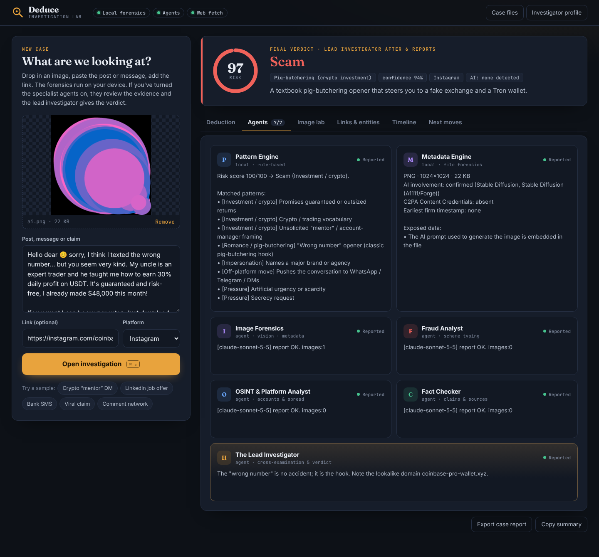

# Deduce

**An open-source investigation lab for debunking scams, disinformation and manipulated images.**

Drop in an image, a post, a DM or a link. Deduce dates the image, checks whether AI generated it, pulls out the information hidden in the file, takes the links apart, and classifies the scheme. With an API key it also hands the evidence to a team of AI specialists. A lead investigator, modelled on Sherlock Holmes's method, cross-examines their reports and delivers the verdict.



## What it does

| Capability | How |
|---|---|
| **Dates an image** | EXIF `DateTimeOriginal`/`Digitized`, XMP create/modify, Photoshop edit history, PNG `tIME`, GPS date stamps. Each is ranked by how far it can be trusted and shown on a timeline |
| **Detects AI generation** | C2PA / Content Credentials, IPTC `DigitalSourceType = trainedAlgorithmicMedia`, embedded Stable Diffusion / ComfyUI prompts, and signatures from Midjourney, DALL·E, Firefly, Imagen, FLUX, Ideogram, Leonardo and others. Generator canvas sizes and noise statistics count only as weak signals |
| **Exposes hidden data** | GPS (with map), camera serial number, owner and author fields, original-document IDs, embedded prompts and comments |
| **Detects manipulation** | Error-level analysis heatmap with hotspot statistics, editing-software traces, impossible timestamp orderings |
| **Traces where it's been** | Facebook `FBMD` markers, platform resize dimensions (Instagram, Facebook, X, WhatsApp), stripped EXIF, recompression quality |
| **Classifies scams** | Phishing, investment/crypto, romance/pig-butchering, job/task, giveaway, advance-fee, impersonation, tech support, recovery scams, marketplace fraud |
| **Detects coordination** | Copy-paste comment rings, hashtag stuffing, mass-tagging, "my advisor" testimonial networks |
| **Dissects links** | Typosquats, punycode homographs, brand-in-subdomain tricks, `@` tricks, shorteners, high-abuse TLDs, redirect chains, tracking parameters |
| **Extracts entities** | Crypto wallets (with block-explorer links), phone numbers, handles, emails, money amounts |
| **Agent team** *(optional)* | Image Forensics (vision), Fraud Analyst, OSINT & Platform Analyst and Fact Checker run in parallel. The Lead Investigator then reconciles their reports and returns a structured verdict |

Every finding is labelled **proof**, **strong** or **weak**. Missing metadata is never treated as proof of AI.

## Quick start

Requires Node.js 22 or later. There are no dependencies to install.

```bash
git clone https://github.com/<you>/deduce.git
cd deduce
cp .env.example .env    # optional: add ANTHROPIC_API_KEY / FIRECRAWL_API_KEY
npm start               # → http://localhost:4400
```

Without keys, the local engines still run fully: image forensics, pattern detection, link analysis and timelines.

| Variable | Enables |
|---|---|
| `ANTHROPIC_API_KEY` | The five-agent team, including vision analysis of the image |
| `FIRECRAWL_API_KEY` | Robust page fetching and web search to corroborate claims |
| `DEDUCE_LEAD_MODEL` / `DEDUCE_AGENT_MODEL` | Model overrides |

## Make it your investigator

Open **Investigator profile** and describe who you are, what you investigate and how you want the reasoning done. You can paste in the instructions of an existing assistant, such as your own "Sherlock" bot. Every agent reads this profile before it starts.

## Privacy

Images are parsed **in your browser**. Nothing leaves your machine unless you enable the agents. Then a downscaled copy and the extracted findings go to the Anthropic API. Case history lives in your browser's localStorage.

## Architecture

```
public/forensics.js   image container parsers (JPEG/PNG/WebP/HEIC), EXIF/XMP/IPTC/C2PA, ELA, AI signatures
public/scam.js        rule engine: scam patterns, link analysis, entity extraction, coordination signals
public/app.js         case orchestration, local reasoning, UI
server.js             zero-dependency Node server: static files + /api/agent, /api/lead, /api/fetch, /api/search
test/run.js           npm test
```

## Limitations

- Metadata can be forged or stripped. Deduce reports what the file says and how far to trust it.
- Statistical AI detection is unreliable on its own. Deduce treats it as a weak signal by design.
- Facebook, Instagram and LinkedIn block anonymous page fetches. Paste the post text instead.
- This is an aid to judgement and does not replace it. Verify before you accuse anyone publicly.

## Contributing

New scam patterns, generator signatures and platform fingerprints are the most valuable contributions. See [CONTRIBUTING.md](CONTRIBUTING.md).

## License

[MIT](LICENSE)
